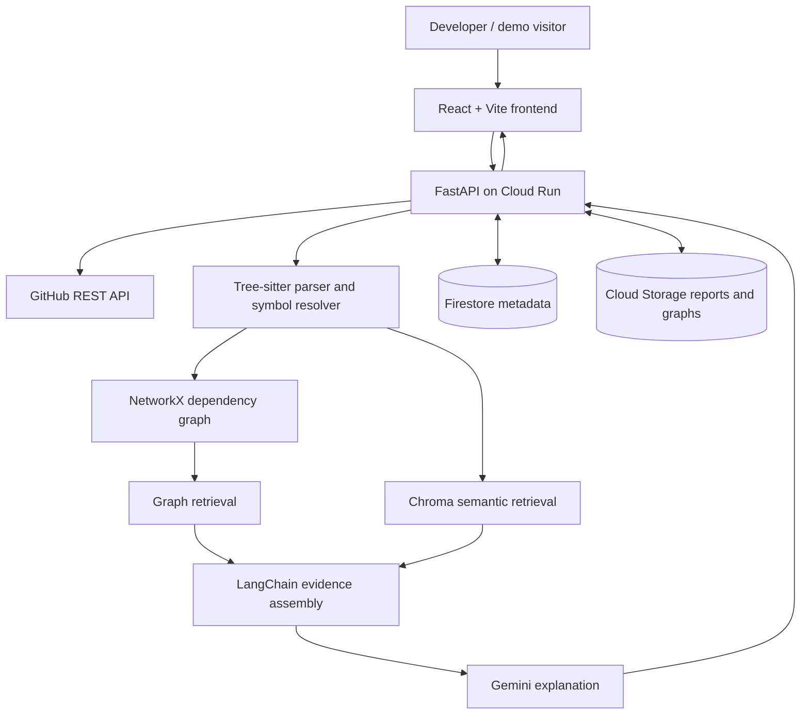

# CodeScope AI: Architecture

## Purpose

CodeScope AI is a hosted GitHub pull request impact analyser for developers reviewing unfamiliar Python/FastAPI codebases. It identifies changed symbols, traces supported call relationships to potentially affected functions and API routes, and explains findings using retrieved source evidence.

**Core promise:** Show what a PR might affect, why, and the exact code supporting each finding. Do not claim static analysis proves runtime behaviour or finds every dependency.

## Users and benefits

- **Primary:** Python backend developers assessing the impact of changes before merging.
- **Secondary:** PR reviewers checking downstream effects without manually tracing every call.
- **Later:** New team members exploring architecture; general repository chat is not an MVP goal.

## MVP scope

- Public GitHub PRs from small, approved Python/FastAPI repositories.
- Compare base and head revisions; identify added, modified and removed functions.
- Extract imports, definitions, calls and FastAPI route declarations using Tree-sitter.
- Resolve supported direct calls and imports; explicitly label unresolved or uncertain relationships.
- Trace reverse dependencies to potentially affected API endpoints.
- Provide an interactive graph, source links pinned to commit SHAs, and an evidence-grounded AI summary.
- Host a public read-only demo with precomputed reports; restrict live analyses to control costs.

**Out of scope initially:** Multiple languages, voice, private repositories, executing project code, automated fixes, unrestricted public scanning, multi-agent systems, comprehensive test coverage claims.

## Technology decisions

| Layer | Choice | Why |
| --- | --- | --- |
| Frontend | React, TypeScript, Vite | Interactive application with inexpensive static hosting; no need for Next.js server features. |
| UI and graph | Tailwind CSS, shadcn/ui, React Flow | Interface components and explorable dependency paths. |
| Backend | Python, FastAPI, Pydantic | REST endpoints, structured validation, compatible with analysis tooling. |
| GitHub integration | GitHub REST API | PR metadata, diffs and source at pinned commits. |
| Parser | Tree-sitter (`tree-sitter-python`) | Function, class, import and call extraction with source positions. |
| Graph | NetworkX | In-memory call graph and reverse-reachability analysis. |
| RAG | LangChain, Gemini | Source-grounded explanations and later tool-using Q&A. |
| Vector search | ChromaDB, initially ephemeral/in-memory | Semantic retrieval without an always-on vector service. |
| Main database | Google Cloud Firestore | Small repository and analysis metadata records. |
| Artefacts | Google Cloud Storage | Persistent report and graph JSON; optional caching. |
| Hosting | Google Cloud Run | One FastAPI container, scaling to zero when idle. |
| Tests | pytest, Vitest | Analysis correctness and frontend checks. |
| CI | GitHub Actions | Automated checks on changes. |

**Open questions:** Choose frontend static host (Firebase Hosting or another free static host); exact Gemini model/API tier; whether to persist or rebuild Chroma indexes. Firestore and Cloud Storage should only be added when persistence is needed. No always-running database, graph server or worker is necessary for the initial demo.

## System design

For initial development, the analysis runs in the same Cloud Run container as the API. Use bounded request timeouts, one active analysis per instance and limits on repository size. A background queue and separate worker are **options under consideration** if longer jobs make synchronous requests impractical.

### Analysis flow

1. User submits a supported GitHub PR URL; API validates identifiers and usage limits.
2. GitHub client fetches PR metadata, changed files and base/head source at fixed commit SHAs.
3. Tree-sitter extracts symbols, imports, calls and route declarations from relevant code.
4. Resolver constructs supported call edges with locations and resolution status.
5. Diff mapper associates changed lines with symbols across both revisions.
6. NetworkX traverses reverse call paths to potential callers and FastAPI routes.
7. RAG retrieves graph paths plus relevant source, documentation and test snippets. Chroma provides optional semantic matches.
8. LangChain sends bounded, cited context to Gemini for an impact explanation.
9. API returns graph nodes, edges, evidence links, uncertainties and summary; optional storage keeps finished reports.

**Evidence rule:** Static analysis owns structural facts; Gemini interprets supplied evidence. Missing or ambiguous call edges stay unresolved, not invented.

### Agentic extension (later)

Offer read-only tools such as `find_symbol`, `trace_callers`, `find_affected_routes` and `search_code`. A LangChain tool-using agent could select tools for follow-up questions. This is **not required for the first MVP**. Limit tool calls and model usage.

## User stories

| ID | Priority | Story / outcome |
| --- | --- | --- |
| US-01 | Must | Submit a supported GitHub PR URL and see analysis status or a clear error. |
| US-02 | Must | Identify added, modified and removed functions with file and line references. |
| US-03 | Must | Trace supported caller relationships and flag unresolved edges. |
| US-04 | Must | See potentially affected FastAPI routes and the paths connecting them. |
| US-05 | Must | Read a concise AI impact explanation grounded in source evidence. |
| US-06 | Later | Ask follow-up questions against indexed code and graph evidence. |
| US-07 | Later | Receive candidate relevant tests with supporting reasons, not coverage guarantees. |
| US-08 | Must | Explore an interactive dependency graph and selected paths. |
| US-09 | Must | Open source locations pinned to the analysed GitHub revision. |
| US-10 | Later | Reopen cached analyses without repeating work. |
| US-11 | Must | View precomputed demo reports without signing in. |
| US-12 | Must | See meaningful progress, timeout and error states. |
| US-13 | Must | Keep live analyses restricted and bounded to prevent abuse and costs. |

MVP acceptance: Demonstrate a change to an authentication helper reaching the correct callers and endpoints, plus an unrelated change that does **not** produce false affected routes. All identified edges require inspectable evidence.

## API outline

| Method | Path | Result |
| --- | --- | --- |
| `POST` | `/api/analyses` | Request a permitted PR analysis. |
| `GET` | `/api/analyses/{id}` | Status and summary. |
| `GET` | `/api/analyses/{id}/graph` | Nodes and dependency edges. |
| `GET` | `/api/analyses/{id}/report` | Findings, uncertainties and source links. |
| `GET` | `/health` | Basic availability check. |

Exact response schemas and synchronous versus queued request semantics remain **open design details**.

## Constraints, security and cost

- **Budget:** Target £0 and keep the practice deployment below **£5/month**. Free allowances are conditional, not guaranteed spending caps.
- Cloud Run minimum instances `0`, maximum instances initially `1`; avoid Cloud SQL, Redis, Kubernetes and permanent worker instances.
- Enable billing alerts, model request limits and conservative logging. Ordinary alerts do not automatically stop charges.
- Accept only parsed GitHub PR identifiers, not arbitrary URLs. Start with an approved repository allowlist and an access token for live analysis.
- Limit files, bytes, processing time, concurrency and LLM calls. Do not execute repository code or install its dependencies.
- Treat repository text as untrusted data, including prompt-injection attempts. Do not include secrets or private repositories.
- Cloud Run local storage is ephemeral. Save durable reports in Cloud Storage; store metadata in Firestore where needed.
- Cache by repository, base SHA, head SHA and analyser version to avoid repeat work.

## Evaluation

Use small hand-labelled Python/FastAPI fixtures and later 30–50 real or controlled changes. Measure call-edge precision/recall, endpoint-impact precision/recall, unresolved relationships, latency and model cost. Compare graph-assisted analysis with simple text search and semantic retrieval. Do not assert an improvement without measurements.

## Potential first steps

1. Create the `codescope-ai` GitHub repository and local folders: `backend/`, `frontend/`, `fixtures/`, `infra/`, `docs/`.
2. Add `ARCHITECTURE.md`, `AGENTS.md`, a concise `README.md` and `.gitignore`; make the initial commit.
3. Create a tiny sample FastAPI fixture with an imported authentication helper, callers, two routes and tests.
4. Implement Tree-sitter extraction of functions/classes, qualified names and source positions (US-02); test nested functions and syntax errors.
5. Add import resolution and a NetworkX call graph, including explicit unresolved edges (US-03).
6. Detect FastAPI routes and trace paths to changed symbols (US-04).
7. Introduce PR diff mapping and pinned source links (US-01, US-09).
8. Build structured report JSON before adding Gemini; evaluate with positive and negative fixtures.
9. Add LangChain retrieval and a bounded Gemini summary (US-05), then React Flow UI (US-08).
10. Deploy a restricted Cloud Run demo with precomputed reports, monitor spending and add optional Firestore/Cloud Storage persistence.

## Deferred ideas

GitHub App/CI integration, background indexing with Cloud Tasks, separate workers, persistent vector indexes, test selection, general codebase Q&A, agentic follow-ups, additional languages and voice interaction. Add only after the core impact analyser is evaluated and deployed.
